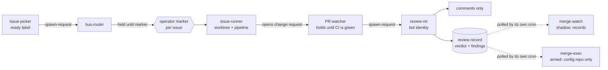

# The issue-to-PR chain

> **TL;DR** — Separate scripts pick a ready issue, run the pipeline in a
> worktree, open a pull request, and enqueue an independent review under a
> different credential. A human marker gates the code-landing stage. The merge
> stage merges unattended on the config repository and only records what it
> would do everywhere else. [[wiki/harness/index|↑ Wiki]]

## What it does

Each stage is a script that talks to the next through a message bus, not
through a shared session. The stages below are the ones present in code.

## How it works

The picker only queues work from repositories on its opt-in list. The router
treats the `issue-runs` channel as irreversible and confirm-enforced, so a
request without the operator's marker is held and re-checked each cycle. The
router also caps land-capable spawns per cycle and honors a halt file. The
runner's default is a dry run; opening a change request needs `--live` plus a
confirmation variable.

## Cadence and identity

Every stage is a cron entry in one registry, and nothing is event-driven. The
router, the PR watcher and the armed merger run every ten minutes; the picker
and the merge shadow run hourly. A ready issue therefore reaches a review in
tens of minutes at best, never faster than the operator sets the marker, and
not before CI is green on the head to be reviewed.

| Stage | Acts as |
|---|---|
| Review | a least-privilege bot token; the wrapper refuses the operator's |
| Merge executor | its own credential file; a missing key is a halt, with no fallback to a token that happens to work |
| Runner opening a change request | on Forgejo with `tea`: `agent-bot`, through a bot-only config, halting before the push on any other login; other tracker CLIs are not pinned |

The last row was a known defect until 2026-10-22, when the runner stopped
taking whatever login `tea` held. The push that precedes it still runs under
the operator's SSH key, so a loop's commit on a branch is not attributable from
the record. The backlog tracks that as must-fix; the operator decided to move
the loops to a per-repository deploy key. The review and merge stages show the
intended pattern.

## Design choices

- **Review is a fresh process with its own credential.** The watcher enqueues
  a new session, and the review wrapper uses a least-privilege bot token
  rather than the operator's. Independence is protocol and identity together,
  as in [[wiki/harness/concepts/principal-agent-framing]].
- **A review waits for green CI.** The watcher asks the forge whether the
  pushed head declares workflows, and if it does, enqueues nothing while their
  status is pending, red, missing or unreadable. A fix that turns CI green
  moves the head, and the moved head would be reviewed again. A repository
  without CI is never held.
- **Review output is reversible.** Autoposted reviews never perform the
  platform approval, so the review stage can fire without a per-run marker.
- **Merge is split into a decider and an executor.** `merge-watch` contains no
  merge call at all, so a shadow run cannot be flipped by a flag
  ([[wiki/harness/concepts/shadow-before-authority]]). `merge-exec` is a separate file that
  is inert without `--arm`; only its cron wrapper passes the flag, pinned to
  the config repository.

## Limits

- The final merge is human everywhere except the config repository. There the
  executor has run armed from cron since 2026-10-15, at most one merge per run;
  the project repositories have no merger. Its header names the cron wrapper
  as the only scheduled caller that passes `--arm`.
- A review counts as done only when its verdict row exists, which is why a
  killed review is retried instead of silently skipped.
- A head whose CI never reports gets no review. The watcher escalates that
  once after two hours; it does not start the review anyway.
- Markers are one-shot and per issue, so throughput is bounded by the
  operator, by design.
