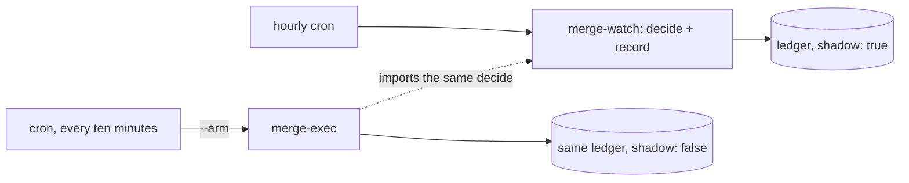

# Shadow before authority

> **TL;DR** — The autonomous merger was built as two scripts. One decides and
> records, hourly, and contains no merge call. The other can merge, and is a
> separate file. Since 2026-10-15 the second runs armed from cron, on this
> repository only, and the shadow keeps running beside it.
> [[wiki/harness/index|↑ Wiki]]

## The idea

A decision procedure that will eventually act without a human first runs where
it cannot act. Its verdicts go to a ledger and are compared with what happened.
Authority is a separate, later change, read on its own.

## Where it is enforced

- **The shadow has no write path.** `merge-watch.py` says it holds no merge call
  "not behind a flag, not behind an env var". A test walks the syntax tree and
  fails if any request carries a body, a method override, or more than a URL
  positionally. Its first version grepped for the word "POST" and proved nothing
  (see [[wiki/harness/concepts/verify-the-verifier|verify the verifier]]).
- **The effector is another file.** `merge-exec.py` imports the shadow's
  predicate rather than copying it, so what decides is what was measured. It
  merges only with `--arm`. The registry now has a second row, `merge-exec`,
  every ten minutes, whose wrapper passes `--arm` with `--repo` pinned to the
  config repository; no other cron caller passes the flag. The script's own
  header still says nothing runs it that way. That sentence predates the row
  and is stale. The shadow loop keeps its hourly row.
- **Containment is the forge, not the code.** The merge bot is a separate
  account, and whether it may merge is decided by the branch-protection merge
  whitelist on `main`, which the merger never reads. A proof script shows the
  same pull request refused without the whitelist entry and merged with it. On
  2026-10-15 the same switch was drilled on this repository: with the bot
  removed, an armed run got `405 User not allowed to merge PR`; with it re-added,
  an armed run started by hand, not from cron, merged #373. The forge setting
  is not visible from the repository; the drill and the current entry are as
  the closed ticket records them.

## Status, from the code, the ticket and the ADR

The merger is armed on this repository and on no other. The registry row, the
wrapper and the closing note of the ticket that tracked the step agree. The
operator installed the crontab line by hand on 2026-10-15 at 23:06 UTC; the
installed crontab is not in the repository, so that rests on the ticket, which
quotes the line and a renderer dry-run reporting the active entries unchanged.
The first cron run, at 23:13 UTC, merged #370 as `merge-bot`. A run merges at
most one pull request (`MAX_MERGES_PER_RUN = 1`), so six runs an hour allow at
most 144 merges a day. The three project repositories the PR watcher also
serves have no merger, and their merges are still by hand.

The ADR has not caught up. It is still marked *Proposed*, and its follow-ups
still say the bot is in no merge whitelist, "which is what keeps this ADR
unarmed". The ticket records the bot in the whitelist since 2026-09-30.

## What it costs / where it does not reach

The original arming condition, an empty stop list from the shadow corpus, turned
out to be unreachable: the corpus held no closed-unmerged pull request, because
review had made abandonment rare. The ADR replaced it with a backtest, of which
only a minority of historic cases were replayable, plus proofs with positive
controls. That is thinner evidence than the plan wanted. The stop list stays as a tripwire.

The kill-switch drill found two gaps, both open. The per-run cap counts merges,
not merge calls, so a refused call moves on to the next candidate: the refused
run in the drill made two merge calls. And a run in which the forge refuses
every merge exits 0, so a kill switch tripped by accident, say by a protection
edit that drops the bot, shows only in the ledger. Arming any other repository
waits on a third ticket, `protected-paths-are-shaped-for-one-repo`, because the
protected-path guard is shaped for this one.

Shadow is not always the answer. A bus-routing policy engine was kept in shadow
permanently, since flipping it would let a data typo disable a guard. The
producer-axis change skipped shadow because the divergence was already known
([[wiki/harness/decisions/agent-changes-default-to-review|agent changes default to review]]).
